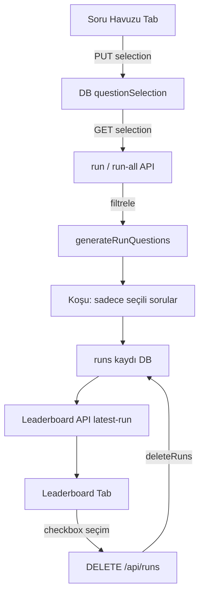

# 4 Maddelik İyileştirme — Mimari Tasarım

> Talep: (1) Leaderboard üstündeki model sıralaması bölümünü kaldır, (2) test sonuçlarına
> seçim kutusu + kalıcı toplu silme, (3) soru havuzuna seçim kutuları (default hepsi seçili),
> (4) daha ayırt edici puanlama.

## Mevcut Durum Analizi

| Bileşen | Durum |
|---|---|
| [`LeaderboardTab.tsx`](../src/components/dashboard/LeaderboardTab.tsx:265) | Tablonun üstünde radar seçimi için model pill'leri bölümü var (kaldırılacak) |
| [`db.ts`](../src/lib/db.ts:196) | `addRun` var; run silme fonksiyonu YOK |
| [`BenchmarkSuiteTab.tsx`](../src/components/dashboard/BenchmarkSuiteTab.tsx:130) | Standart sorular salt-okunur listeleniyor; seçim kutusu yok |
| [`question-generators.ts`](../src/lib/question-generators.ts:555) | `generateRunQuestions()` her koşuda 16 soru üretir; filtre yok |
| [`benchmark-suite.ts`](../src/lib/benchmark-suite.ts:373) | Deterministik puanlama kaba katmanlı (0/60/100) — modeller ayrışmıyor |

## Madde 1 — Üst Model Sıralaması Bölümünü Kaldır

**Sorun:** Tablonun üstündeki pill butonları bölümü gereksiz yer kaplıyor; modeller zaten
tablo satırlarında sıralı duruyor.

**Çözüm:**
- Pill bölümü (satır 265-283) tamamen kaldırılır.
- Radar karşılaştırma seçimi tabloya taşınır: her satıra "karşılaştır" ikon butonu
  (Radar/BarChart2 ikonu) eklenir — tıklayınca `selectedModelIds` state'ine ekler/çıkarır.
- Seçili satırların ikonu vurgulanır; grafikler bölümü korunur.

## Madde 2 — Test Sonuçlarına Kalıcı Toplu Silme

**Veri modeli:** Leaderboard satırı = modelin en güncel koşusu (`runId` alanı zaten var).
Silme hedefi: `data/benchmark_db.json` içindeki `runs[]` kayıtları.

**Yeni API:** `DELETE /api/runs`
- Body: `{ runIds: string[] }`
- `db.ts`'ye `deleteRuns(runIds: string[]): Promise<number>` — ID eşleşen tüm run
  kayıtlarını kalıcı siler, silinen sayıyı döner.
- Yanıt: `{ deleted: n }`

**UI (LeaderboardTab):**
- Tablonun en soluna checkbox sütunu; başlıkta "tümünü seç" kutusu.
- Tablonun üstüne seçim sayısını gösteren kırmızı "Seçilenleri Sil (N)" butonu
  (0 seçiliyken disabled). Silme öncesi `confirm()` onayı.
- Silme sonrası leaderboard yeniden yüklenir — silinen modelin eski bir koşusu varsa
  latest-run mantığı gereği o görünür olur, yoksa satır kaybolur.

## Madde 3 — Soru Havuzu Seçim Kutuları

**Veri modeli:** `db.ts` şemasına yeni bölüm:
```ts
questionSelection?: { enabledQuestionIds: number[] }  // yoksa = hepsi seçili
```

**Yeni API:** `GET/PUT /api/questions/selection`
- GET: `{ enabledQuestionIds: number[] | null }` (null = hiç ayarlanmamış, hepsi seçili)
- PUT: `{ enabledQuestionIds: number[] }` — boş diziye izin verilmez (en az 1 soru).

**UI (BenchmarkSuiteTab):**
- Her standart sorunun soluna checkbox; default işaretli.
- Başlıkta "Tümünü Seç / Temizle" anahtarı + seçili soru sayısı göstergesi.
- Değişiklik anında PUT ile DB'ye yazılır (otomatik kaydetme).

**Koşu entegrasyonu:**
- `run` ve `run-all` API'leri: `generateRunQuestions()` sonrası seçim okunur,
  seçili olmayan soru ID'leri filtrelenir. Seçim yoksa (null) tüm sorular çalışır.
- Özel (custom) sorular seçimden bağımsız her zaman çalışmaya devam eder.

## Madde 4 — Ayırt Edici Puanlama

Süre aynı kalır (16 soru) ama **her kategoriden 2 farklı zorlukta soru** üretilir ve
**deterministik puanlama granülerleştirilir**. Böylece 4-5 modelin aynı kategoride
100/50 gibi kaba eşitlenmesi yerine 92.5 / 85 / 67.5 gibi ayrışan skorlar oluşur.

### a) Zorluk seviyeli dinamik üretim

Her üreticiye `difficulty: 'easy' | 'hard'` parametresi eklenir; her koşuda her
kategoriden kolay + zor olmak üzere 2 soru üretilir:

| Üretici | Kolay | Zor |
|---|---|---|
| Q1 kelime sıralama | 3 kelime | 6 kelime |
| Q2 çarpım | 2×2 basamak | 3×3 basamak |
| Q3 mantık (yaş/kutular) | küçük sayılar | büyük sayılar |
| Q4 JSON | 3 alan | 5 alan + iç içe |
| Q5 IFEval | 2 kural | 4 kural |
| Q6 sayı dizisi | kısa dizi | uzun dizi |
| Q7 needle | kısa haystack | uzun haystack |
| Q8 adversarial | küçük sayılar | büyük sayılar |
| Q14/Q15/Q16 Türkçe | 3 tip zaten var — kolay varyant eklenir | zor varyant |

Soru ID şeması: `id = baseId * 10 + (0=kolay, 1=zor)` (örn. Q1 kolay=10, Q1 zor=11).
Böylece ID çakışması olmadan filtreleme ve raporlama çalışır.

### b) Granüler deterministik puanlama

Kaba 0/60/100 katmanları yerine ince katmanlar:

| Soru | Yeni puanlama |
|---|---|
| Q1 sıralama | tam=100, 1 pozisyon yanlış=70, 2-3 yanlış=40, kötü=10 |
| Q2/Q3/Q8 matematik | tam=100, ±%1 tolerans=85, ±%10=50, değil=0 |
| Q4 JSON | tüm alanlar=100, 1 alan hatalı=70, 2+=40, parse yok=0 |
| Q5 IFEval | tüm kurallar=100, 1 ihlal=60, 2 ihlal=25 |
| Q7 needle | tam eşleşme=100, büyük/küçük harf farkı=75, yakın=50, yok=0 |
| Q14 ek düzeltme | etiket+doğru=100, etiket+yakın kök=80, metinde=60, kısmen=30 |
| Q15 deyim | anahtar kapsamı ×70 + etiket 30 (zaten oranlı) |
| Q16 özet | kelime(40)+anahtar(40)+etiket(20) zaten oranlı |

### c) Leaderboard etkisi

Kategori skoru = o kategorinin 2 sorusunun ortalaması → 100+85=92.5 gibi ara değerler.
Hibrit kategorilerde (logic/code/turkish) hakem puanı zaten sürekli 0-100 verdiğinden
ortalama doğal olarak ayrışır.

## Uygulama Sırası

1. Madde 1: LeaderboardTab pill bölümü kaldır + satıra karşılaştır butonu
2. Madde 2: db.ts `deleteRuns` + DELETE /api/runs + LeaderboardTab checkbox/silme UI
3. Madde 3: db.ts questionSelection + GET/PUT /api/questions/selection +
   BenchmarkSuiteTab checkbox UI + run/run-all filtreleme
4. Madde 4: question-generators difficulty parametreleri + ID şeması +
   benchmark-suite granüler puanlama + BenchmarkSuiteTab etiketleri
5. TS build + canlı doğrulama (tsx test scripti + curl API kontrolleri)

## Veri Akışı


