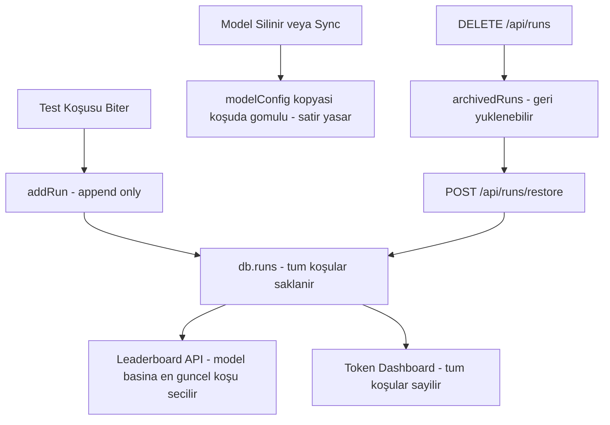

# Test Sonucu Kalıcılığı (Run Persistence) — Mimari Tasarım

## Problem

Kullanıcı isteği: **Bir model için yapılan test sonucu hiçbir koşulda silinmemeli.**
Model erişilemez olsa bile (LM Studio'dan silinse, sunucu kapalı olsa) leaderboard'da
kalmalı. Daha önce ekrandan/sistemden silinen sonuçlar geri getirilmeli.

### Mevcut silme kaynakları (tespit edildi)

| # | Kaynak | Davranış | Sorun |
|---|--------|----------|-------|
| 1 | `addRun()` — `src/lib/db.ts:214` | Yeni koşu eklenince aynı modelin eski koşularını `filter` ile fiziksel siler | Model geçmiş kayıtları kaybolur |
| 2 | `/api/models/sync` — duplicate temizliği (`route.ts:74`) | Duplicate model kaydı silinince o kayda bağlı koşuları da siler | Koşu geçmişi kaybolur |
| 3 | `/api/models/sync` — ölü kayıt temizliği (`route.ts:92`) | LM Studio kütüphanesinde olmayan modelin kaydını VE koşularını siler | "Model erişilemez olsa bile sonuç kalmalı" ihlali |
| 4 | `deleteRuns()` + `DELETE /api/runs` + Leaderboard "Seçilenleri Sil" | Manuel toplu kalıcı silme | Kullanıcı artık hiçbir silme istemiyor |

### Kurtarma imkanı

`data/benchmark_db.json` git geçmişine commit edilmiş (`.gitignore`'da `data/` yok).
4 commit'te DB anlık görüntüleri mevcut: `9246608`, `b01acdb`, `ea74d86`, `af9fff8`.
Silinen koşular bu anlık görüntülerden `run.id` bazında birleştirilerek geri getirilebilir.

## Mimari Karar: Append-Only Koşu Arşivi

Koşu kayıtları **append-only** olur: `db.runs` dizisine yalnızca ekleme yapılır,
fiziksel silme kod yolları tamamen kaldırılır. Leaderboard zaten "model başına en
güncel koşu" mantığıyla (`latestRunByModel`) çalıştığı için birden fazla koşu
saklansa bile her model tek satır gösterir — UI davranışı değişmez, veri kaybı biter.

Koşu kendi içinde `modelConfig` kopyasını (denormalize) taşır; bu yüzden model
kaydı `db.models`'ten silinse bile koşu ve leaderboard satırı yaşar.

## Değişiklik Adımları

### 1. `src/lib/db.ts` — `addRun()` append-only
- `db.runs.filter(...)` satırı kaldırılır; koşu yalnızca `push` edilir.
- Aynı `run.id` zaten varsa (idempotent tekrar) üzerine yazar, eklemez.

### 2. `src/lib/db.ts` — DB şemasına `archivedRuns` + migration
- `DBSchema`'ya `archivedRuns: BenchmarkRun[]` eklenir.
- `ensureDB()` mevcut dosyada alan yoksa boş dizi ile tamamlar (geriye dönük uyumlu).
- `deleteRuns()` fiziksel silme yerine koşuları `runs` → `archivedRuns`'a taşır
  (geri dönüşüm kutusu; yanlış API çağrılarında bile veri kaybı olmaz).
- Yeni `restoreRuns(runIds)`: arşivden `runs`'a geri taşır.
- Yeni `restoreAllArchivedRuns()`: tüm arşivi geri yükler.

### 3. `src/app/api/models/sync/route.ts` — koşuları asla silme
- Duplicate temizliği: kaybeden kaydın koşuları silinmez; `modelConfig.id`'leri
  kazanan kaydın ID'sine **re-parent** edilir (koşu geçmişi korunur).
- Ölü kayıt temizliği: LM Studio'da olmayan modelin kaydı `db.models`'ten
  silinebilir AMA koşuları aynen kalır (run kendi `modelConfig` kopyasını taşır).
- Rapor metinleri bu yeni davranışı yansıtır.

### 4. `src/app/api/runs/route.ts` — arşiv + geri yükleme
- `DELETE /api/runs` → koşuları arşive taşır, silmez. Yanıt: `{ archived: n }`.
- Yeni `POST /api/runs/restore` → `{ runIds?: string[] }` (boşsa tümü) arşivden
  geri yükler. Yanıt: `{ restored: n }`.

### 5. `src/components/dashboard/LeaderboardTab.tsx` — silme UI'ı kaldır
- "Seçilenleri Sil" butonu, checkbox sütunu ve ilgili state/handler kaldırılır.
- Koşular artık UI'dan silinemez (kullanıcı isteği: "hiçbir zaman silinmemeli").

### 6. Kurtarma script'i — `scripts/restore-deleted-runs.ts`
Git geçmişindeki TÜM `data/benchmark_db.json` sürümlerinden koşuları toplar:
1. `git log --all --format=%H -- data/benchmark_db.json` ile commit listesi.
2. Her commit için `git show <sha>:data/benchmark_db.json` parse edilir.
3. Koşular `run.id` bazında birleştirilir (aynı ID → en yeni commit'in sürümü).
4. Mevcut DB'de olmayan koşular `db.runs`'a eklenir (mevcutlar korunur).
5. Koşuların `modelConfig`'ine karşılık gelen model kaydı `db.models`'te yoksa
   koşudaki gömülü kopyadan geri oluşturulur (leaderboard + detay için).
6. Rapor: geri getirilen koşu sayısı, model başına döküm.

Çalıştırma: `npx tsx scripts/restore-deleted-runs.ts`

### 7. Doğrulama
- `npx tsc --noEmit` temiz.
- Dev sunucuda `/api/leaderboard` — geri getirilen modellerin satırları görünür.
- Yeni test çalıştırınca eski koşuların silinmediği DB'den teyit edilir.

## Veri Akışı (sonrası)

## Riskler ve Önlemler

- **DB boyutu büyür**: Her koşu ~50-100 KB; append-only kabul edilebilir. İleride
  gerekiyorsa arşiv sıkıştırma eklenebilir (kapsam dışı).
- **Token dashboard toplamları değişir**: Eski koşular da sayılacağı için değerler
  büyür — bu "hiçbir şey silinmesin" isteğiyle tutarlıdır.
- **Aynı modelin çok koşusu**: Leaderboard tek satır garantisi `latestRunByModel`
  mantığıyla korunur; `getRunsByModel` re-parent sonrası tutarlı çalışır.
